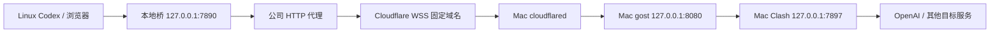

# TransCodex

让受限网络中的 Linux 通过公司 HTTP 代理、Cloudflare Named Tunnel 和家中 Mac 的 Clash 出口使用 Codex CLI。工作区和命令执行留在 Linux；提示词、代码上下文和工具输出仍会发送给云端模型。

**完整步骤见：[完整配置与使用手册](docs/完整配置与使用手册.md)**。从资源准备、域名 DNS、Mac 服务、Linux 桥到 Codex/浏览器使用，每一步均包含原因、命令、预期结果及失败处理。



无需 ECS、EIP、家庭固定公网 IP 或入站端口映射。Mac 需要在线、唤醒，转发组件和 Clash 保持运行。Mac 上的 Codex App、终端或目标网站网页不需要一直打开。

## 文档导航

| 文档 | 用途 |
| --- | --- |
| [完整配置与使用手册](docs/完整配置与使用手册.md) | 首次部署和日常使用的主入口 |
| [Linux 安装入口](NEXT_LINUX.md) | 新旧桥的区别与迁移入口 |
| [恢复连接](RECONNECT.md) | 已部署环境的检查和恢复 |
| [历史实测摘要](docs/历史实测摘要.md) | 成功证据、遗留故障与验证边界 |
| [设计与历史方案](docs/设计与历史方案.md) | 已脱敏的早期设计，部分部署状态为历史描述 |
| [AGENTS.md](AGENTS.md) | 项目背景、数据边界和维护约定 |

## 当前验证状态

- **历史远端部署已成功：**固定域名、公司代理、历史 Python 桥、Mac gost/Clash 路径完成过真实 ChatGPT 订阅 Codex 请求，返回 `CONNECTION_OK`（2,390 tokens）；历史 CLI 为 0.164.0。
- **新参考桥已补齐：**`scripts/cfws_bridge.py` 使用独立 JSON 配置、Python 3.8+ 标准库，支持 HTTP/1.1 WebSocket、Ping/Pong、分帧和受限并发，附离线协议及本地 TLS 集成测试。它没有替换历史远端部署，真实路径与长期运行仍需验收。
- **待验证：**模型目录刷新超时、过夜和断网恢复、ChatGPT/Gemini 网页登录及完整对话。Named Tunnel 提供稳定地址，不承诺连接永不中断。

## 从哪里开始

1. 准备自己的域名、Cloudflare 账号、可用的 Mac Clash 出口和允许连接入口的 Linux 网络。
2. 按手册生成项目外的私人配置并部署两端服务。
3. 逐层验证：公司 CONNECT 200 → 外层 TLS → WebSocket 101 → gost 认证 CONNECT 200 → API 无凭据 401 → 一次真实 Codex 订阅请求。
4. 网页对话需 Linux 浏览器使用本地 HTTP/HTTPS 代理 `127.0.0.1:7890` 并自行登录。

所有 `example.com`、`proxy.example.net` 和用户路径都是示例，需要换成自己的值。此仓库不提供公共代理账号。

## 本地开发验证

```sh
python3 -m unittest discover -s tests -v
```

本地集成测试需要 OpenSSL 命令生成临时证书；不访问模型、不读取真实凭据、不修改现有服务。详细覆盖范围见手册。

## 公开内容范围

本仓库发布通用说明、无秘密模板、源码及测试。含历史凭据的原始外部调试记录保留在维护者本地，由 `.gitignore` 排除，公开版本以脱敏摘要替代。真实配置、密码、token、Clash 订阅、Codex 登录缓存和日志均不应提交。
