# TransCodex 完整配置与使用手册

本文面向首次搭建者。按顺序操作，可建立“受限 Linux → 公司 HTTP 代理 → Cloudflare → 家中 Mac → Clash → 目标网站”的转发链路，供 Linux 上的 Codex CLI 使用，也可进一步测试 ChatGPT、Gemini 网页对话。

维护日期：2026-11-05。所有 `example.com`、`proxy.example.net`、`YOUR_USER` 都是占位符，必须换成自己的值。示例域名不是本项目提供的公共服务。

## 目录

1. [方案适用范围与验证状态](#1-方案适用范围与验证状态)
2. [理解组件与端口](#2-理解组件与端口)
3. [准备资源与参数](#3-准备资源与参数)
4. [取得项目文件](#4-取得项目文件)
5. [检查 Mac 的 Clash 出口](#5-检查-mac-的-clash-出口)
6. [把域名 DNS 接入 Cloudflare](#6-把域名-dns-接入-cloudflare)
7. [安装 Mac 软件](#7-安装-mac-软件)
8. [生成私人配置](#8-生成私人配置)
9. [启动并托管 Mac gost](#9-启动并托管-mac-gost)
10. [创建 Named Tunnel 和公共路由](#10-创建-named-tunnel-和公共路由)
11. [从 Linux 验证入口](#11-从-linux-验证入口)
12. [在 Linux 安装桥](#12-在-linux-安装桥)
13. [验证并使用 Codex](#13-验证并使用-codex)
14. [浏览器访问 ChatGPT 与 Gemini](#14-浏览器访问-chatgpt-与-gemini)
15. [日常使用与启动顺序](#15-日常使用与启动顺序)
16. [分层故障排查](#16-分层故障排查)
17. [稳定性验收](#17-稳定性验收)
18. [迁移、备份、轮换与卸载](#18-迁移备份轮换与卸载)
19. [安全、可见性与 SSH](#19-安全可见性与-ssh)
20. [配置字段与文件清单](#20-配置字段与文件清单)
21. [开发验证与参考资料](#21-开发验证与参考资料)

## 1. 方案适用范围与验证状态

### 1.1 什么情况下适用

- Linux 无法直接访问 OpenAI 等目标，但可以通过一个 HTTP 代理连接某个获准的自有 HTTPS 域名。
- 公司代理允许 HTTPS CONNECT，以及 CONNECT 内的 TLS 和 WebSocket。
- Mac 能通过已有 Clash 出口访问目标服务，并可持续在线。
- 你拥有一个域名，并能管理注册商的 NS 委派以及 Cloudflare 账号。

不要仅凭“某国内 IP 能访问”推断本方案必然可用。最关键的前提是第 11 节的远端实测。若指定入口不被允许，应先确认可用的获准入口。

### 1.2 为什么选择这条路线

Mac 上的 cloudflared 主动连接 Cloudflare，不需要为家庭网络开放入站端口。Linux 连接固定域名，不依赖家庭公网 IP；Mac 换网后 connector 可重新建立连接。Named Tunnel 避免了开发用随机地址需要更新的问题。

本方案不要求 ECS、EIP、家庭固定公网 IP、路由器端口映射，也不依赖 Linux 能使用 UDP。**域名不是公网服务器，也不是 EIP。**

### 1.3 已验证与尚未验证

| 项目 | 状态 | 含义 |
| --- | --- | --- |
| 历史 Python 桥 + Mac gost + Cloudflare 固定入口 | 已有远端实测 | 通过公司代理完成过一次真实 Codex ChatGPT 订阅任务 |
| 订阅测试 | 返回 `CONNECTION_OK`，报告 2,390 tokens | 当次完整请求成功，不证明过夜稳定 |
| 历史环境版本 | gost 3.3.1、cloudflared 2026.10.7、Codex CLI 0.164.0 | 复现参考，不要求把其他已有环境强行切成这些版本 |
| 本仓库新 `cfws_bridge.py` | 本地协议与隔离集成测试 | 为从零搭建补齐的参考实现，未替换历史远端桥，真实路径需另行验收 |
| 模型目录刷新 | 曾超时，推理仍成功 | 待定位，不能宣称已经修复 |
| ChatGPT/Gemini 网页 | 架构上可复用 | 本项目尚无 Linux 完整登录及对话成功记录 |
| 过夜、断网恢复、登录刷新 | 未完成验收 | 不承诺“永不断连”或连接无损恢复 |

曾出现 Mac 本地 gost 探测正常、connector 就绪，但 Mac 访问公网入口 TLS 超时的情况。进程正常不等于所有访问路径正常，也不能以 Mac 自测失败代替 Linux 的实测结果。

## 2. 理解组件与端口

```mermaid
flowchart LR
  A[Linux Codex / 浏览器] -->|HTTP CONNECT 到本地代理| B[Linux 桥 127.0.0.1:7890]
  B -->|公司 HTTP CONNECT| C[公司代理]
  C -->|TLS + HTTP/1.1 WebSocket /ws| D[Cloudflare relay.example.com:443]
  D -->|Named Tunnel 已建立的连接| E[Mac cloudflared]
  E -->|本地 HTTP WebSocket| F[Mac gost 127.0.0.1:8080]
  F -->|认证 CONNECT 后经上游链| G[Mac Clash 127.0.0.1:7897]
  G --> H[Clash 上游出口]
  H --> I[OpenAI / Gemini 等目标]
```



| 组件/端口 | 所在设备 | 作用 | 为什么这样设置 |
| --- | --- | --- | --- |
| `127.0.0.1:7890` | Linux | 给 Codex/浏览器使用的本地 HTTP CONNECT 代理 | 仅回环，避免把公司机器变成局域网代理 |
| 公司代理，例如 `proxy.example.net:80` | 公司网络 | Linux 出网入口 | 桥显式使用它，不依赖交互 shell 环境 |
| `relay.example.com:443` | Cloudflare | 固定 WSS 入口 | 在受限出口上承载加密 WebSocket |
| `127.0.0.1:8080` | Mac | gost WebSocket `/ws` + 带认证 CONNECT | 只接受本机 cloudflared 回源 |
| `127.0.0.1:7897` | Mac | Clash HTTP/混合代理 | gost 显式经过已有可用出口 |
| `7844` | Mac → Cloudflare | connector 的出站链路 | 与 Linux 的 WSS/443 是不同连接；可能用 QUIC/UDP 或 HTTP/2/TCP |
| `20241`～`20245` | Mac 本地 | cloudflared 默认指标服务候选端口 | 诊断 connector，不向公网开放 |

“HTTPS 通过 HTTP 代理”并不矛盾：客户端向代理发送 CONNECT，建立字节通道后，再与目标站点做内层 HTTPS。网站证书校验继续由 Linux 的客户端执行。外层 WSS 在 Cloudflare 终止，Cloudflare 可以接触代理认证和目标 CONNECT 元数据；不要将整条链路描述为完全不解密。

协议依据见 [Chromium 代理说明](https://chromium.googlesource.com/chromium/src/+/main/net/docs/proxy.md) 与 [Cloudflare 连接配置](https://developers.cloudflare.com/tunnel/configuration/)。

## 3. 准备资源与参数

### 3.1 资源清单

| 资源 | 要求 | 检查方法 |
| --- | --- | --- |
| Mac | 可联网、有可用 Clash、可长期接电在线 | 在 Mac 浏览器和终端分别验证目标访问 |
| Linux | systemd、curl、Python 3.8+、普通用户；安装系统服务需要 sudo | `python3 --version`、`command -v systemctl` |
| Python | 桥只用标准库；新部署优先选择仍受维护的 Python 版本 | 不假设 RHEL 8 默认 `/usr/bin/python3` 足够新 |
| 域名 | 已注册、可修改 NS | 登录注册商确认控制权 |
| Cloudflare 账号 | 可添加站点和 Named Tunnel | 登录自己的管理后台 |
| AI 账号 | 对应网站可用的账号；Codex 以 ChatGPT 登录为本方案目标 | 不把中转当成购买/共享账号的方式 |
| 安装包来源 | 官方软件源或获准的离线分发 | 不在受限 Linux 上反复尝试直连安装站点 |

桥的语法最低要求为 Python 3.8，本次本地验证使用 Python 3.9；其他解释器版本部署前也应运行测试。老系统只有 Python 3.6 时，先通过发行版支持的方式安装较新解释器，并在 systemd 中填写其绝对路径。不要替换系统工具依赖的 Python。

### 3.2 先填写自己的参数

| 参数 | 示例 | 使用位置 |
| --- | --- | --- |
| 根域名 | `example.com` | 注册商、Cloudflare |
| 中转域名 | `relay.example.com` | Cloudflare 路由、Linux `endpoint` |
| 隧道名称 | `transcodex-home` | Cloudflare 后台，任意可识别名字 |
| Mac Clash 端口 | `7897` | gost 出站链 |
| Mac gost 端口 | `8080` | gost 与 Tunnel 回源 |
| Linux 本地桥端口 | `7890` | 桥、Codex 启动器、浏览器 |
| 公司代理 | `http://proxy.example.net:80` | Linux 桥的 `corp_proxy` |
| Linux 服务用户 | 当前普通用户 | systemd `User=` 与文件归属 |
| Codex 路径 | `command -v codex` 的结果 | 启动器 `CODEX_RELAY_BIN`，必要时指定 |

所有文档统一用 `relay.example.com`。入口叫什么不会限制只能访问某一个 AI 产品。代理连接的实际目标由客户端 CONNECT 请求决定。

## 4. 取得项目文件

**在 Mac 执行：**

```sh
git clone https://github.com/YuLL-g/YL_Cloudflarre.git TransCodex
cd TransCodex
```

如没有 Git，可从 GitHub 的 **Code → Download ZIP** 下载、解压，再进入解压后的目录。

**原因：**下面的 `scripts/...` 和 `examples/...` 路径以项目根目录为工作目录。Mac 与 Linux 不必位于相同目录，也不需要传输你的业务项目仓库。

**预期：**能看到 `scripts/cfws_bridge.py`、`scripts/prepare-config.py` 和本文。

Linux 如不能访问 GitHub，可由 Mac 通过获准的渠道传输本项目工具或压缩包。桥没有 pip 依赖；不要为安装桥临时修改系统全局网络。

## 5. 检查 Mac 的 Clash 出口

### 5.1 确认客户端和端口

打开 Clash 客户端，确认上游节点可用，在客户端设置中核对 HTTP 或混合端口。例如使用 `7897`：

```sh
lsof -nP -iTCP:7897 -sTCP:LISTEN
```

**原因：**浏览器能打开网站，可能依赖系统代理或 TUN；gost 则必须显式知道哪个本地 HTTP 代理可用。

**预期：**看到监听该端口的进程。如果没有，先修复 Clash，不进入下一步。端口不同就替换后续参数，不要强行占用已有端口。

### 5.2 做不消耗模型额度的网络验证

```sh
curl --proxy http://127.0.0.1:7897 --noproxy '' \
  --connect-timeout 10 --max-time 20 \
  --silent --show-error --output /dev/null \
  --write-out 'status=%{http_code}\n' https://api.openai.com/v1/models
```

**预期：**无 OpenAI 凭据时返回 `status=401`。这表明经过 Clash 能到达该 API，但不证明 ChatGPT 订阅登录、网页或 Gemini 都可用。

**失败怎么办：**`000` 常伴随网络/TLS 错误，先查 Clash 端口和上游；`403` 需看来源及响应原因。不要加 `-k` 跳过证书校验。

## 6. 把域名 DNS 接入 Cloudflare

### 6.1 在 Cloudflare 添加站点

1. 登录自己的 Cloudflare 账号，选择添加现有域名/站点。
2. 填根域名，例如 `example.com`，选择适合自己的计划；不要因为本文选择额外付费产品。
3. 核对导入的 DNS 记录，特别是已有网站的 A/CNAME、邮箱的 MX/TXT、域名验证记录。
4. 记录 Cloudflare **为这个站点实际分配**的两台 NS。

**原因：**后面 Tunnel 的公共应用路由需要在自己的 Cloudflare DNS 区域创建记录。不能直接复制别人站点的 NS。

### 6.2 在注册商修改 NS

进入阿里云或其他注册商的“DNS 服务器/修改 DNS”页面，将原 NS 替换成 Cloudflare 分配值，然后保存。

**区别：**这是修改 DNS 托管委派，域名注册商仍可保持原商家；不属于域名转出。新注册域名的注册商转移限制，不等同于禁止修改 NS。若控制台确实禁止修改，按注册商提示核实账户或域名状态。

如果域名已有 DNSSEC，迁移前核对 Cloudflare 和注册商的 DNSSEC 迁移说明，避免保留不匹配的旧 DS 导致解析失败。本文不自动修改现有 DNSSEC。

### 6.3 验证委派

```sh
dig NS example.com +short
```

也可在能正常访问公网 DNS 服务的设备查询：

```sh
curl --silent --show-error \
  'https://dns.google/resolve?name=example.com&type=NS'
```

**预期：**记录与分配的 Cloudflare NS 一致，Cloudflare 站点为 Active。传播存在缓存，NS 未一致时先等待和核查，不急着建立多套隧道。

**注意：**Clash fake-IP 模式可能返回 `198.18.0.x` 等地址。它反映本机代理的解析行为，不能代替公共权威 DNS 的检查。根域名没有 A 记录也不妨碍发布后面的子域名。

参考 [Cloudflare 完整 DNS 接入](https://developers.cloudflare.com/dns/zone-setups/full-setup/setup/)。

## 7. 安装 Mac 软件

已有正在运行的环境先查看版本，不要为阅读本文升级所有组件。

### 7.1 cloudflared 与 Python

若已安装 Homebrew：

```sh
brew install cloudflared python
cloudflared --version
python3 --version
```

没有 Homebrew 时，先按 [Homebrew 官网](https://brew.sh/) 安装；不要在不了解脚本来源时复制第三方安装命令。也可使用 Cloudflare 官方安装包。

### 7.2 安装 gost

本项目历史验证使用 gost **3.3.1**。以下固定资产只适用于 Apple Silicon `arm64`：

```sh
uname -m
mkdir -p "$HOME/.local/bin"
TRANS_GOST_TMP=$(mktemp -d /tmp/transcodex-gost.XXXXXX)
curl --fail --location \
  --proxy http://127.0.0.1:7897 \
  'https://github.com/go-gost/gost/releases/download/v3.3.1/gost_3.3.1_darwin_arm64.tar.gz' \
  --output "$TRANS_GOST_TMP/gost.tar.gz"
shasum -a 256 "$TRANS_GOST_TMP/gost.tar.gz"
```

历史已核对的该资产 SHA-256：

```text
6b87b8c5fd728536d1b208382fc6b93a7bb04111d633a9f1e4651cd1ce62886d
```

**必须先核对哈希，完全一致后再执行：**

```sh
tar -xzf "$TRANS_GOST_TMP/gost.tar.gz" -C "$TRANS_GOST_TMP"
install -m 700 "$TRANS_GOST_TMP/gost" "$HOME/.local/bin/gost"
"$HOME/.local/bin/gost" -V
```

**原因：**固定版本和摘要使安装可复核，避免误下载架构或替换成不兼容程序。若资产下架或摘要不同，停止并到 [官方 Releases](https://github.com/go-gost/gost/releases) 核查，不跳过校验。Intel Mac 应选择对应架构的官方包及其独立摘要，不能套用上面的 arm64 摘要。

## 8. 生成私人配置

### 8.1 新部署使用配置生成器

**在 Mac、项目根目录执行，先把两个示例值换掉：**

```sh
python3 scripts/prepare-config.py \
  --hostname relay.example.com \
  --corp-proxy http://proxy.example.net:80 \
  --clash-port 7897
```

Linux 没有公司代理、可直接连接 Cloudflare 时可用 `--corp-proxy ''`。本项目原场景需要公司代理，不能省略实际地址。当前参考实现不支持带账号密码的公司代理认证；遇到公司代理 407 时需按获准方式扩展，不要把公司密码写进命令 URL。

**发生什么：**生成器在项目外创建以下文件，目录为 0700，文件为 0600；随机生成新密码，不把密码打印到终端。

| 文件 | 用途 | 是否传给 Linux |
| --- | --- | --- |
| `~/.config/transcodex/gost.json` | Mac gost 配置 | 否 |
| `~/.config/transcodex/relay-password.txt` | 本地探测读取的代理密码 | 否 |
| `~/.config/transcodex/bridge.json` | Linux 桥端点、认证、公司代理与心跳参数 | 是，私下传输 |
| `~/.config/transcodex/com.transcodex.gost.plist` | Mac LaunchAgent 定义 | 否 |

生成器不会启动服务，也不会覆盖已有文件。若提示文件已存在，说明可能已有部署，应转到第 18 节；不要先删除正在使用的配置。

### 8.2 为什么配置必须在项目外

`gost.json` 和 `bridge.json` 含真实代理密码，任何得到密码的人都可能使用公开入口。Base64 是编码，不是加密。即使仓库是私有，也不应提交真实凭据、隧道 token 或 Codex 登录缓存。

公开模板在 `examples/`，其中 `REPLACE_WITH_NEW_PASSWORD` 不能用于正式服务。

## 9. 启动并托管 Mac gost

### 9.1 理解 gost 配置

生成的配置与 [`examples/gost.macos.example.json`](../examples/gost.macos.example.json) 结构相同：

- `services[].addr` 为 `127.0.0.1:8080`；不对局域网开放。
- `listener.type` 为 `ws`，`metadata.path` 为 `/ws`。
- `handler.type` 为 `auto`，启用用户名 `codex` 和随机密码。
- `handler.chain` 指向 Clash 链；HTTP 上游为 `127.0.0.1:7897`。
- 日志级别为 warn，不开启包含认证正文的调试记录。

**原因：**入口是 cloudflared 转来的 WebSocket，里面承载带认证的 HTTP CONNECT；gost 的目标出站必须经过 Clash，不能依赖 GUI 系统代理被服务自动继承。

### 9.2 安装用户 LaunchAgent

```sh
umask 077
mkdir -p "$HOME/Library/LaunchAgents" "$HOME/Library/Logs/TransCodex"
chmod 700 "$HOME/Library/Logs/TransCodex"
touch "$HOME/Library/Logs/TransCodex/gost.out.log" \
      "$HOME/Library/Logs/TransCodex/gost.err.log"
chmod 600 "$HOME/Library/Logs/TransCodex/"*.log
install -m 600 "$HOME/.config/transcodex/com.transcodex.gost.plist" \
  "$HOME/Library/LaunchAgents/com.transcodex.gost.plist"
plutil -lint "$HOME/Library/LaunchAgents/com.transcodex.gost.plist"
launchctl bootstrap "gui/$(id -u)" \
  "$HOME/Library/LaunchAgents/com.transcodex.gost.plist"
```

**预期：**plist 校验 OK，`8080` 开始监听：

```sh
lsof -nP -iTCP:8080 -sTCP:LISTEN
launchctl print "gui/$(id -u)/com.transcodex.gost" |
  awk '/^[[:space:]]*(state|pid) = /'
```

LaunchAgent 随当前用户登录运行，`KeepAlive` 可在进程退出后重新拉起。关闭终端不影响它，退出用户登录会影响它。重复 bootstrap 报已加载时，先检查状态，不要再运行第二个前台 gost 抢端口。

### 9.3 验证 Mac 本地全链路

```sh
python3 scripts/check-relay.py ws://127.0.0.1:8080/ws
```

**预期 JSON 字段：**

```json
{
  "websocket_upgrade": 101,
  "authenticated_connect": 200,
  "openai_tls_verified": true,
  "openai_http_status": 401
}
```

脚本在本机进程里读取私人密码文件，不打印它。该测试先排除 Mac gost/Clash 问题，再测试公网入口。不要把它当成外地公司代理或订阅请求的验收。

## 10. 创建 Named Tunnel 和公共路由

### 10.1 创建远程管理 Tunnel

1. 登录 Cloudflare 管理后台，进入 **Networking → Tunnels**；部分版本在 Zero Trust 的 Networks/Connectors 中。
2. 选择创建 `cloudflared` 隧道，命名为 `transcodex-home`。
3. 选择 macOS 和正确架构。若已安装 cloudflared，跳过重复安装步骤。
4. 页面提供带 token 的安装/运行命令。在自己的 Mac 终端执行它，token 只在本机保管，不截图分享、不粘贴到仓库。
5. 若目标是系统启动运行，使用页面对应的管理员服务安装方式；安装后确认服务实际处于 `system` 域。

**原因：**远程管理隧道的路由由后台维护；不要再为同一隧道同时创建一套本地 `config.yml`/证书配置，避免来源冲突。

**预期：**后台出现 Mac connector，状态 Healthy/Connected。本场景历史安装形成了系统 LaunchDaemon `/Library/LaunchDaemons/com.cloudflare.cloudflared.plist`。

### 10.2 发布应用路由

进入该 Tunnel 的 **Routes → Add route → Published application**，填写：

| 项目 | 值 |
| --- | --- |
| Subdomain | `relay` |
| Domain | 自己的根域名，例如 `example.com` |
| Path | 留空 |
| Service URL | `http://127.0.0.1:8080` |

保存后确认子域名 DNS 记录已创建。

**为什么回源是 HTTP：**cloudflared 与 gost 在同一 Mac 上，回环连接承载 WebSocket；面向 Linux 的外层入口仍是 HTTPS/WSS。这里不要填 `https://127.0.0.1:8080`，因为 gost 当前没有在该端口提供 TLS。

**为什么 Path 留空：**让该主机名的请求到达 gost；客户端自己请求 `/ws`。路由条件不是 WebSocket 目标 URL 的替代品，也不会自动改写路径。

不要将子域名 A 记录指向家庭 IP。正常 Tunnel 路由使用 Cloudflare 创建的记录关联到隧道。

### 10.3 检查服务与公网入口

```sh
launchctl print system/com.cloudflare.cloudflared |
  awk '/^[[:space:]]*(state|pid) = /'
python3 scripts/mac-status.py
python3 scripts/check-relay.py wss://relay.example.com/ws
```

最后一条预期与第 9.3 节相同；它默认使用 Mac 当前进程的直接 socket 路径，不会自动读取系统 HTTP 代理。如果 Mac 自身到 Cloudflare 的这一路失败，要与 Linux 的入口实测分别记录。

**避免泄密：**不要将原始 `launchctl print`、cloudflared plist 或完整进程参数发给别人，它们可能包含 token。`mac-status.py` 仅显示状态、PID、监听、就绪和连接数量。

启用 Cloudflare Access 交互登录会改变握手响应。当前参考桥没有 Access service token 接入，不能直接打开 Access 登录保护后期待桥自动登录。此方案默认依赖 gost 认证；要增加 Access，需实现并验证机器身份请求头。

参考 [Cloudflare 后台创建 Tunnel](https://developers.cloudflare.com/cloudflare-one/networks/connectors/cloudflare-tunnel/get-started/create-remote-tunnel/) 与 [macOS 服务](https://developers.cloudflare.com/tunnel/features/locally-managed-tunnels/as-a-service/macos/)。

## 11. 从 Linux 验证入口

这一节在**外地 Linux**执行。Mac 成功不能证明公司网络允许该入口。把域名和公司代理替换成自己的值。

### 11.1 测试公司 CONNECT 与外层 TLS

```sh
curl --proxy http://proxy.example.net:80 --noproxy '' \
  --http1.1 --connect-timeout 10 --max-time 20 \
  --head https://relay.example.com/
```

**预期：**先见公司代理 `200 Connection established`；随后根路径可能 `404 Not Found`，这是因为 gost 没有提供普通首页。

**原因：**这一步只确认公司代理允许该域名，以及外层 TLS 能完成。根路径 404 无需重建隧道。

如果返回公司代理拒绝、302 DNS 错误或 TLS 校验失败，先定位这一层。代理 302 并不唯一代表域名不存在；企业 CA 需求应通过正规信任配置处理，不能关闭 TLS 校验。

### 11.2 测试 WebSocket Upgrade

```sh
curl --proxy http://proxy.example.net:80 --noproxy '' \
  --http1.1 --connect-timeout 10 --max-time 8 --include --no-buffer \
  -H 'Connection: Upgrade' \
  -H 'Upgrade: websocket' \
  -H 'Sec-WebSocket-Version: 13' \
  -H 'Sec-WebSocket-Key: dGhlIHNhbXBsZSBub25jZQ==' \
  https://relay.example.com/ws
```

**预期：**CONNECT 200 之后是 `101 Switching Protocols`，且：

```text
Sec-WebSocket-Accept: s3pPLMBiTxaQ9kYGzzhZRbK+xOo=
```

收到 101 后，8 秒无业务数据，curl 可能以 `(28)` 超时退出。这是命令的 `--max-time 8` 主动结束，并不表示 Upgrade 失败。

**边界：**尚未测试 gost 认证、目标 HTTPS 或 Codex 订阅。本命令不携带代理密码，也没有发起模型请求。

## 12. 在 Linux 安装桥

### 12.1 区分新部署与已有部署

全新环境按本节安装仓库中的参考实现。已有 `cfws-bridge.service` 正在使用的环境，先阅读第 18.1 节备份和迁移；新程序使用 JSON 配置，不能直接用历史常量更新器代替。

### 12.2 准备目录与文件

**在 Linux 执行：**

```sh
mkdir -p "$HOME/.local/bin" "$HOME/.config/transcodex"
chmod 700 "$HOME/.config/transcodex"
python3 --version
```

通过获准的文件传输渠道，送达以下文件：

| 来源 | Linux 目标 | 性质 |
| --- | --- | --- |
| Mac 生成的 `~/.config/transcodex/bridge.json` | `~/.config/transcodex/bridge.json` | 私密配置，不能经公共仓库传输 |
| 本项目 `scripts/cfws_bridge.py` | `~/.local/bin/cfws_bridge.py` | 普通源码，可随公开仓库获取 |
| 本项目 `scripts/codex-relay` | `~/.local/bin/codex-relay` | 普通启动器 |

若 Linux 可访问自己的 Mac SSH 且此传输获准，可以使用 SCP；否则使用已有获准的文件传递方式。本方案不额外建立 SSH 入站、VPN 或路由。

Linux 上设置权限：

```sh
chmod 600 "$HOME/.config/transcodex/bridge.json"
chmod 700 "$HOME/.local/bin/cfws_bridge.py" "$HOME/.local/bin/codex-relay"
python3 "$HOME/.local/bin/cfws_bridge.py" \
  --config "$HOME/.config/transcodex/bridge.json" --check
```

**预期：**`Configuration valid; private values not displayed.`。脚本还检查配置归属、回环监听、WSS 地址、端口及超时范围。

**原因：**密码不再嵌入代码，更新程序与轮换秘密可以分开进行。目录 0700 和配置 0600 限制其他本机用户读取。

### 12.3 先以前台模式验证

```sh
python3 "$HOME/.local/bin/cfws_bridge.py" \
  --config "$HOME/.config/transcodex/bridge.json"
```

**预期：**出现 `bridge ready on loopback port 7890`。此时先保留这个终端，在另一个 Linux 终端执行：

```sh
curl --proxy http://127.0.0.1:7890 --noproxy '' \
  --connect-timeout 10 --max-time 30 \
  --silent --show-error --output /dev/null \
  --write-out 'status=%{http_code}\n' https://api.openai.com/v1/models
```

**预期：**`status=401`。如果返回 502，表示本地桥接受了请求，但建立上游通道失败，按日志阶段排查。

新桥的日志只记录阶段和异常类型，不记录目标请求正文、认证头或密码。它支持每个 CONNECT 新建一条 WebSocket、握手缓冲保留、跨帧 CONNECT、Ping/Pong、受限并发和取消清理。它不透明重放已经开始的业务请求。

### 12.4 配置 systemd 系统服务

前台测试通过后，在前台终端按 `Ctrl+C` 退出，避免服务占用同一端口。

取得真实用户名、HOME 和解释器路径：

```sh
id -un
printf '%s\n' "$HOME"
command -v python3
```

复制 [`examples/cfws-bridge.service.example`](../examples/cfws-bridge.service.example) 到 Linux 临时文件，用编辑器替换：

- `User=YOUR_USER`：换成 `id -un` 的值。
- 所有 `/home/YOUR_USER`：换成实际 HOME，不能假定一定在 `/home`。
- `ExecStart` 第一项 `/usr/bin/python3`：换成满足版本要求的实际解释器绝对路径。

例如：

```sh
cp examples/cfws-bridge.service.example /tmp/cfws-bridge.service
vi /tmp/cfws-bridge.service
sudo install -m 644 /tmp/cfws-bridge.service /etc/systemd/system/cfws-bridge.service
sudo systemd-analyze verify /etc/systemd/system/cfws-bridge.service
sudo systemctl daemon-reload
sudo systemctl enable --now cfws-bridge.service
```

如果只传输了模板文件、没有项目目录，第一条命令的来源路径改成模板实际存放位置。任一步失败先处理，不继续把失败视为成功。

**为什么填写绝对路径：**systemd 不读取你的 `.bashrc`、shell 函数和交互 PATH。服务也不需要从环境继承公司代理，程序从配置中显式读取。

**为什么普通用户运行：**7890 大于 1024，不需要 root 监听。服务限制对系统和 HOME 的写入；配置必须属于 `User=` 指定的用户。`Restart=always`/5 秒可恢复进程退出，不能修复仍存活但网络不可用的服务。

检查：

```sh
systemctl is-active cfws-bridge.service
systemctl is-enabled cfws-bridge.service
ss -lntp 'sport = :7890'
journalctl -u cfws-bridge.service -n 50 --no-pager
```

**预期：**active、enabled、仅回环监听。再运行一次 401 探测，确认托管后仍可用。无权查看系统日志时用 sudo，但无需以 root 运行 Codex。

## 13. 验证并使用 Codex

### 13.1 安装或保留现有 CLI

先执行：

```sh
command -v codex
codex --version
```

已有 CLI 先沿用，历史实测 0.164.0 不等于必须全量升级。全新安装按 [OpenAI 官方 CLI 文档](https://learn.chatgpt.com/docs/cli/reference) 和发行说明选择安装方式；npm 用户常用：

```sh
node --version
npm --version
npm install -g @openai/codex
```

如前两条命令不存在，先按 [Node.js 官方下载与安装说明](https://nodejs.org/en/download)及发行版软件管理方式安装满足 Codex 当前要求的 Node.js/npm，再重开终端验证。没有 npm 的环境也可从 [Codex 官方 Releases](https://github.com/openai/codex/releases)选择匹配 Linux 架构的预编译发布包，按对应版本说明安装到用户可执行目录；不要用 Mac 的可执行文件代替 Linux 包。

受限网络无法访问 npm 时，通过获准的软件分发方式准备对应 Linux 架构的官方包；不要假定本桥已支持 npm 的全部明文 HTTP、证书和下载依赖。新版本命令支持情况以 `codex --help` 为准。

### 13.2 使用专用启动器

```sh
"$HOME/.local/bin/codex-relay" --version
```

若 Codex 没在普通 PATH 中，显式指定：

```sh
CODEX_RELAY_BIN=/your/absolute/path/to/codex \
  "$HOME/.local/bin/codex-relay" --version
```

启动器仅为 Codex 及其子进程设置大小写 HTTP/HTTPS 代理变量，清理 `ALL_PROXY` 冲突，并直连回环地址。它不改全局系统代理、模型、provider、登录缓存或 shell 配置。

需要让 Codex 子命令直连内网域名时：

```sh
CODEX_RELAY_NO_PROXY=.internal.example,10.0.0.10 \
  "$HOME/.local/bin/codex-relay"
```

请填真实需要的内网域名/IP；不同工具对 NO_PROXY 的语法实现可能不同，不把这一项视作整机路由规则。

### 13.3 确认认证方式

```sh
"$HOME/.local/bin/codex-relay" login status
```

**预期目标：**显示通过 ChatGPT 登录。已经有有效登录态就继续使用，不读取、复制或上传 `auth.json`。

需要登录且 CLI 支持设备码模式时：

```sh
"$HOME/.local/bin/codex-relay" login --device-auth
```

按终端提示，在可打开认证页面的浏览器完成本人授权。账号/工作区可能需要启用设备码登录；浏览器登录与 CLI 设备码轮询都必须可达。设备码不可用时按官方支持方式处理，不把 Mac 的登录缓存复制进仓库或聊天。

说明依据 [OpenAI 官方认证文档](https://learn.chatgpt.com/docs/auth)。这里保留 ChatGPT 订阅路线；API Key 是另一种认证方式，不能把 API 探测成功或持有订阅理解成任意 API 访问已获授权。

### 13.4 只做一次最小真实请求验收

```sh
(
  TRANS_CHECK_DIR=$(mktemp -d /tmp/transcodex-check.XXXXXX) || exit 1
  cd "$TRANS_CHECK_DIR" || exit 1
  "$HOME/.local/bin/codex-relay" exec --skip-git-repo-check --sandbox read-only \
    '不要调用工具，不要读取文件，只回复 CONNECTION_OK。'
)
```

**原因：**空目录与明确提示减少无关文件上下文，验证的是完整订阅请求，而非单纯网页状态码。模型由你的现有设置决定，本文不强制改模型。

**预期：**最终返回 `CONNECTION_OK`。该请求会消耗对应账号的使用额度；日常健康检查不要反复调用模型。

曾出现 `failed to refresh available models: request timed out`，但实际推理成功。模型目录与公共 `/v1/models` 不是同一请求；保留该错误待定位，不先重置登录、改 API Key 或认定整个隧道失败。

### 13.5 日常在项目目录使用

```sh
cd /path/to/your/project
"$HOME/.local/bin/codex-relay"
```

工作区、工具命令、构建和测试留在 Linux。发送给模型的提示词、代码上下文和工具输出仍会传往服务提供商；“本地执行”不等于“内容不出网”。

## 14. 浏览器访问 ChatGPT 与 Gemini

### 14.1 这是复用网络，不是共享 Mac 浏览器

Linux 浏览器直接打开 `https://chatgpt.com/` 或 `https://gemini.google.com/app`，地址栏保持原域名。Mac 只负责转发，不需要打开对应网页，也不自动转移 Mac 的登录状态。

如果原先失败来自网络不可达，这条中转可以提供另一条访问路径；账号权限、服务可用地区、浏览器兼容或站点风控仍需要满足。Mac 能打开是出口条件，Linux 的页面、登录、资源加载和流式回复仍必须单独验证。

### 14.2 使用独立 Firefox 配置

为避免影响日常内网浏览，建议建立独立浏览器配置，例如 `TransCodex`。Firefox 可通过地址栏 `about:profiles` 管理配置，或按当前版本的配置管理界面操作。

在这个配置的设置页面搜索“代理/proxy”，进入连接设置，选“手动代理配置”：

| 设置 | 内容 |
| --- | --- |
| HTTP 代理 | `127.0.0.1` |
| 端口 | `7890` |
| 同时将此代理用于 HTTPS | 勾选；若界面有单独 HTTPS 字段，也填同一地址和端口 |
| SOCKS | 留空；此端口不是 SOCKS 服务 |
| 不使用代理 | 至少保留 localhost、127.0.0.1，并按需要加入实际内网目标 |

**原因：**终端给 Codex 设置的环境变量不会自动配置已经运行的浏览器；网页登录、静态资源和对话可能涉及多个关联域名，需要一并经过可用路径。

此参考桥只实现 CONNECT。HTTPS 可通过 CONNECT 建立通道，普通明文 HTTP 网页请求不受支持。专用浏览器优先访问完整的 `https://` 地址，避免期望所有非 HTTPS 网站也能通过本桥工作。

Firefox 的设置入口随版本变化，以 [Firefox 官方代理说明](https://support.mozilla.org/en-US/kb/connection-settings-firefox) 为准。

### 14.3 Chrome/Chromium 的独立实例示例

如果安装的是 Google Chrome，可在 Linux 启动单独的数据目录：

```sh
google-chrome \
  --user-data-dir="$HOME/.local/share/transcodex-browser" \
  --proxy-server='http://127.0.0.1:7890' \
  'https://gemini.google.com/app'
```

若程序名是 `chromium` 或其他发行版名称，替换第一项。独立数据目录用于让该实例明确应用参数，避免命令被已运行的普通实例接收。目录保存网站登录信息，保持私有，不能上传 GitHub。

`--proxy-server` 指定 HTTP 代理；即使访问 HTTPS 网站，也不要改成 `https://127.0.0.1:7890`。后者要求本地代理端口本身提供 TLS，而当前桥没有提供。

参数依据 [Chromium 官方代理文档](https://chromium.googlesource.com/chromium/src/+/main/net/docs/proxy.md)。不要为了代理添加忽略证书或禁用浏览器沙箱的参数。

### 14.4 网页验收步骤

1. 确认本地桥 401 探测通过。
2. 在专用浏览器打开目标 HTTPS 页面。
3. 自行登录对应账号；不传递 Cookie、账号密码或 Mac 浏览器配置目录。
4. 发送一句普通文字，确认完整回复和后续追问。
5. 闲置数分钟后再发送，观察是否需要刷新。
6. 再测试多个标签页，留意桥的 64 并发限制与资源占用。

打不开时记录浏览器错误、失败的域名、时间和桥日志阶段，分享前去掉 Cookie、Authorization、查询中的认证信息和对话正文。HAR 往往含秘密，不直接上传完整 HAR。

UDP 未通过此桥转发，语音、视频和其他 WebRTC 功能不在当前验收范围。只有 SSH 终端、没有图形界面的 Linux，不能仅凭代理显示网页版，需要另外选择受支持的客户端；不要把 Codex 登录态视为其他产品客户端的通用凭据。

## 15. 日常使用与启动顺序

### 15.1 每天使用前

1. Mac 在线、唤醒，当前用户已登录。
2. Clash 已运行且上游可用。
3. gost LaunchAgent 已运行。
4. cloudflared 系统服务与 Named Tunnel 正常。
5. Linux 的 `cfws-bridge.service` active，并能完成低成本 HTTPS 探测。
6. 在 Linux 启动 `codex-relay` 或专用浏览器。

不要求 Mac 保持 Codex App、Codex CLI、终端窗口或 Gemini 网页打开。Linux 上的交互 Codex 则需要按自己的会话管理方式保持。

### 15.2 本机检查

**Mac，项目目录：**

```sh
python3 scripts/mac-status.py
python3 scripts/check-relay.py ws://127.0.0.1:8080/ws
```

**Linux：**

```sh
systemctl is-active cfws-bridge.service
curl --proxy http://127.0.0.1:7890 --noproxy '' \
  --connect-timeout 10 --max-time 30 --silent --show-error \
  --output /dev/null --write-out 'status=%{http_code}\n' \
  https://api.openai.com/v1/models
```

`mac-status.py` 只是服务及 connector 检查。全链路健康必须结合实际路径探测；401 也只验证该 API 端点。

### 15.3 Mac 睡眠、合盖与开机

Mac 睡眠、断网或关机会使中转中断。接电并在系统设置里按自己的使用要求配置唤醒策略；本文不自动修改电源设置。临时需要防止系统空闲睡眠，可在 Mac 终端运行：

```sh
caffeinate -i
```

该命令运行期间阻止空闲睡眠，`Ctrl+C` 结束；不保证合盖仍运行，也不代替开机登录。FileVault 解锁、Clash GUI 登录依赖、gost 用户 LaunchAgent 与 cloudflared 系统服务的启动时机必须分别验证。

## 16. 分层故障排查

不要默认重启全部组件。先看失败发生在哪一层，修复后从该层继续验证。

| 现象 | 已知信息 | 下一步 |
| --- | --- | --- |
| 本地 7890 Connection refused | 桥没监听或端口不同 | 检查 systemd、解释器、配置权限、占用 |
| `--check` 失败 | 配置/权限不符合要求 | 检查 JSON、占位密码、文件所有者、0600、回环地址 |
| 公司代理返回 302/DNS 错误 | 代理层未建立目标连接 | 检查域名委派、代理解析/策略/缓存；不是直接重启 Mac 的依据 |
| 公司代理返回 407 | 公司代理要求认证 | 当前参考桥不支持公司代理认证；按获准方式处理 |
| TLS 证书错误 | 信任、主机名、时间或检查代理有问题 | 核对系统时间与正规 CA；不关闭校验 |
| 根路径 404 | 普通首页不存在 | 继续测 `/ws`，不要因此重建 Tunnel |
| `/ws` 不是 101 | 路由、路径、回源或边缘策略异常 | 对比 Mac 本地 WS，确认 `/ws` 与回源 HTTP8080 |
| 101 后 curl 8 秒 `(28)` | 若已正确 Upgrade，则测试主动结束 | 继续内层认证探测 |
| Tunnel Healthy，公网 502/1033 等 | connector 与回源可能不同层失败 | 检查 Mac gost8080、路由、实际 connector 状态 |
| 内层 gost 407 | 代理凭据不一致 | 对照私人配置并轮换/重新同步，不输出密码 |
| 桥日志 `local-connect` | 本地请求不是支持的 CONNECT 或目标受限 | 检查浏览器协议/端口与 allowlist |
| 桥日志 `outer-connect-tls-upgrade` | 公司 CONNECT、外层 TLS 或 WS 失败 | 用第 11 节独立探测定位 |
| 桥日志 `relay-auth-connect` | WS 已建立，内层 CONNECT 未完成 | 检查 Mac gost认证和Clash出口，必要时本机完整探测 |
| 桥日志 `stream` TimeoutError | 写阻塞或心跳未获回应 | 检查网络中断、代理空闲策略、上游帧响应 |
| 桥返回 503 | 达到并发上限 | 降低浏览器标签/并发，观察释放，再评估上限 |
| API401，Codex却失败 | API基础可达，不代表订阅鉴权 | 检查登录状态与实际失败阶段，不重置全部配置 |
| 模型目录刷新超时但回复成功 | 请求路径或时限不同 | 单独检查目录请求、桥行为和 CLI 版本；不要宣布已解决 |
| 页面打开、登录或回复失败 | 页面可达只是其中一部分 | 检查关联域名、账号/站点响应与并发/长连接 |

### 16.1 有针对性地重启

Mac gost：

```sh
launchctl kickstart -k "gui/$(id -u)/com.transcodex.gost"
```

Mac cloudflared 系统服务：

```sh
sudo launchctl kickstart -k system/com.cloudflare.cloudflared
```

Linux 桥：

```sh
sudo systemctl restart cfws-bridge.service
```

只有确认故障位于对应组件、或已经修正配置后再使用。重启会关闭现有连接，不能无损恢复已经中断的流式回复。

### 16.2 向别人提供排障信息

提供时间及其时区、操作设备、组件版本、失败阶段、HTTP 状态和耗时。默认日志不记录请求内容；不要开启抓取认证正文后再提交公开 Issue。不要发配置全文、`auth.json`、隧道 token、Clash 订阅或完整进程参数。

## 17. 稳定性验收

Named Tunnel 固定的是地址，不保证每条 WebSocket 永不关闭。Cloudflare 更新、公司代理空闲策略、Mac 网络切换都可能导致断线。[Cloudflare WebSocket 行为](https://developers.cloudflare.com/network/websockets/)

按顺序记录结果：

| 验收 | 操作 | 通过标准 |
| --- | --- | --- |
| 基础链路 | CONNECT、TLS、WS、内层认证、API401 | 每层证据齐全 |
| 完整业务 | 一次 Codex 真实请求 | 最终完整回复 |
| 空闲 | 闲置超过旧桥30秒窗口，再测试数分钟和过夜 | 新请求可用；记录既有流是否断开 |
| 流式与并发 | 长回复、多标签/多请求 | 无截断、无长期增长的连接数 |
| 进程恢复 | 在维护窗口只重启一个组件 | 服务自动启动，基础网络恢复后新请求恢复 |
| 网络恢复 | 短暂断网/换网，再恢复 | 新请求恢复，不能要求旧TCP透明续传 |
| 重启 | 两端分别重启并完成必要登录 | 相关服务及Clash恢复后可用 |
| 无人值守 | 关闭终端、退出登录、合盖分别测试 | 记录真实边界，不混为一个结论 |

历史目标为基础出口恢复后 1–2 分钟内恢复新请求，当前尚未通过真实路径验收。桥没有重放业务、断点续传、常驻通道自动恢复或无限重试逻辑；新请求重新建立连接，业务重试由客户端决定。

不要通过无人值守循环调用模型来测试健康。低频网络探测也应保留超时和退避，避免给公司代理、Cloudflare或目标端点制造持续负载。

## 18. 迁移、备份、轮换与卸载

### 18.1 已有历史桥如何迁移

旧桥通常把 `WS_HOST` 和 Base64 `PROXY_AUTH` 写在 Python 常量中；新桥读取独立 JSON。这两种配置格式不同。

1. 不改变现有 Mac 密码、路由和服务，先在 Linux 对原脚本、unit和配置做私人备份，权限设为0600，放在用户私有目录，不能提交仓库。
2. 确认 Python 版本符合要求。
3. 在 Linux 私人目录准备 `bridge.json`，使用现有有效凭据，或按18.2节完整轮换。不要运行新部署生成器覆盖旧 Mac 配置。
4. 复制新桥为另一个文件名，例如 `cfws_bridge_reference.py`。把私人 JSON 的 `listen_port` 暂设为 `17890`，以前台方式启动新桥。
5. 使用 `curl --proxy http://127.0.0.1:17890` 验证；再仅为一个测试 Codex/浏览器进程指向17890，完成真实业务验证。
6. 验收后安排维护窗口，停止旧服务，改回7890，更新unit程序路径/配置参数并重新加载启动。
7. 若新链路失败，恢复旧unit及脚本并重启。不要把回滚理解成旧随机域名一定仍可用。

仓库中的 `configure-linux-bridge.py` **只用于更新旧脚本的两个常量**，不安装新桥、不修复旧协议代码，也不将旧脚本自动转换为JSON版本。它的旧 `linux-relay-settings.json` 也不是新桥的 `bridge.json`。

### 18.2 轮换代理密码

1. 在维护窗口为新凭据准备私人暂存配置，不把密码放入命令参数或终端输出。
2. 将 Mac gost 的认证与 Linux桥配置同步更新；本地探测用的 `relay-password.txt` 也保持一致。
3. 重启受影响服务，让新连接使用新密码。
4. 验证新密码成功、旧密码不能建立新的代理 CONNECT。
5. 删除不再需要的私人旧凭据备份或存入合适的凭据保管系统。

双方更新之间可能出现短暂407，安排维护窗口。泄露的cloudflared token应在Cloudflare侧轮换connector凭据；gost密码与cloudflared token是不同秘密，不能互相替代。

### 18.3 停止与卸载

Mac 只停止 gost：

```sh
launchctl bootout "gui/$(id -u)" \
  "$HOME/Library/LaunchAgents/com.transcodex.gost.plist"
```

Linux 停止并禁止开机启动：

```sh
sudo systemctl disable --now cfws-bridge.service
```

确认不再需要后再删除对应unit/LaunchAgent和本项目的私人配置。cloudflared系统服务按官方卸载说明处理；如果承载其他应用，先确认依赖。云端Tunnel和DNS路由需要在Cloudflare单独删除，停止进程不会自动删除路由。

浏览器将代理恢复为其原有设置或关闭专用实例；不要把公司原本要求的代理随意改成直连。

## 19. 安全、可见性与 SSH

- 工作区存储及命令执行在Linux，云端推理会收到发送的提示词、上下文和工具输出。
- Linux 应用与桥知道目标域名；本机审计可能记录这些信息。公司HTTP代理通常可见中转域名、连接时间与流量，不保证无法识别最终访问；终端审计或TLS检查会改变可见范围。
- Mac Clash可看到目标连接元数据。Cloudflare可接触外层WSS和里面的代理认证/CONNECT信息，内层网站HTTPS继续校验，不在中转端主动解密网页内容。
- 不在公开仓库保存真实域名、内部代理地址、设备/用户标识、隧道ID或凭据；所有示例使用保留域名。
- 公开入口必须保留认证。默认仅允许目标443；可在桥配置中限制目标域名，但这是Linux本地限制，不能替代Mac入口的服务器端访问控制。密码泄露后应立即轮换并评估gost侧目的地限制。
- 这不是整机VPN。仅明确使用本地代理的程序经中转；普通SSH默认不读取HTTP_PROXY/HTTPS_PROXY，入站sshd也不受本方案端口影响。额外配置ProxyCommand/ProxyJump或系统路由则需独立评估。
- Codex子进程会继承代理，Git的HTTPS请求可能受影响；SSH形式的Git连接通常按原路径。内网工具需配置适当的NO_PROXY。

## 20. 配置字段与文件清单

### 20.1 `bridge.json`

| 字段 | 默认/示例 | 说明 |
| --- | --- | --- |
| `endpoint` | `wss://relay.example.com/ws` | 必须WSS，主机名同时用于证书校验和Host；当前不支持query、fragment或URL凭据 |
| `corp_proxy` | `http://proxy.example.net:80` | 为空字符串则直接连入口；不继承环境代理 |
| `username` / `password` | 私人凭据 | 与Mac gost一致；模板密码会被拒绝 |
| `listen_host` | `127.0.0.1` | 仅允许回环字面地址 |
| `listen_port` | `7890` | 修改后同步所有客户端；`codex-relay`默认固定7890，试验端口时显式设置环境 |
| `connect_timeout` | 20秒 | 本地请求头、外层建立、内层CONNECT各阶段上限，不是整个流的总时长 |
| `write_timeout` | 30秒 | 每次写入背压等待上限；不同于无数据读超时 |
| `ping_interval` | 20秒 | 数据期心跳间隔 |
| `pong_timeout` | 60秒 | 等待对应Pong；失败关闭该通道 |
| `max_connections` | 64 | 同时处理的连接数，上限256 |
| `allowed_ports` | `[443]` | 目标端口限制；不代理UDP |
| `allowed_hosts` | `[]` | 允许所有目标主机；如 `["chatgpt.com", ".openai.com"]`：无点前缀为精确主机，有点前缀含根与子域。示例并非完整产品域名清单 |
| `ca_file` | `null` | 外层WSS额外信任配置的CA文件路径；不关闭主机名校验。内层网站TLS由客户端自行处理 |

心跳不保证已有会话永不关闭。写入背压、服务端关闭和网络切断都会结束会话；客户端应对新请求重建连接。

### 20.2 仓库文件

| 文件 | 用途 |
| --- | --- |
| `README.md` | 入口与当前状态 |
| `docs/完整配置与使用手册.md` | 从零搭建、使用、排障、验收和维护 |
| `docs/历史实测摘要.md` | 不含内部标识与秘密的历史证据 |
| `docs/设计与历史方案.md` | 已脱敏的早期设计；以本手册的新部署步骤为准 |
| `scripts/prepare-config.py` | 一次生成项目外的Mac/Linux私人配置和LaunchAgent |
| `scripts/cfws_bridge.py` | 新Linux桥参考实现；标准库、HTTP/1.1外层 |
| `scripts/codex-relay` | 仅为Codex及子进程配置本地代理 |
| `scripts/mac-status.py` | Mac本地只读状态检查 |
| `scripts/check-relay.py` | Mac本地/公网入口的认证和OpenAIHTTPS探测 |
| `scripts/configure-linux-bridge.py` | 历史桥常量更新辅助工具 |
| `examples/` | 无凭据JSON和systemd模板 |
| `tests/` | 离线协议与本地TLS集成测试 |

原始外部设备调试记录含旧凭据，只保留在维护者本地并被`.gitignore`排除。公开仓库提供摘要，不能从GitHub取得原始秘密材料。

## 21. 开发验证与参考资料

### 21.1 本地测试

在安装了Python 3.8+及OpenSSL命令的开发机器执行：

```sh
python3 -m unittest discover -s tests -v
```

测试只创建本地临时证书、模拟公司HTTP代理与TLS WebSocket服务，不读取你的真实配置，不调用模型，也不启动/重启现有转发服务。测试证书仅临时信任于测试配置，不写系统信任库。

2026-11-05 在开发 Mac 的 Python 3.9 上，18 项测试通过；其中包含配置生成一致性、私密权限、拒绝覆盖和6条并发连接释放测试。新参考桥尚未部署到历史远端 Linux。

覆盖分段头、握手后缓冲、跨帧CONNECT及尾部、空帧、Ping/Pong、错误Accept、非法帧、证书拒绝、心跳失联、并发限制与连接释放。加速心跳测试用于验证状态逻辑，不能代替真实30秒/过夜空闲和公司代理验证。

### 21.2 官方参考

- [Cloudflare：DNS完整接入](https://developers.cloudflare.com/dns/zone-setups/full-setup/setup/)
- [Cloudflare：后台创建远程管理Tunnel](https://developers.cloudflare.com/cloudflare-one/networks/connectors/cloudflare-tunnel/get-started/create-remote-tunnel/)
- [Cloudflare：macOS服务与运行上下文](https://developers.cloudflare.com/tunnel/features/locally-managed-tunnels/as-a-service/macos/)
- [Cloudflare：连接配置与端口](https://developers.cloudflare.com/tunnel/configuration/)
- [Cloudflare：WebSocket连接行为](https://developers.cloudflare.com/network/websockets/)
- [GOST：配置](https://gost.run/en/getting-started/configuration-overview/)、[WebSocket](https://gost.run/en/tutorials/protocols/ws/)、[官方发布](https://github.com/go-gost/gost/releases)
- [OpenAI Docs：Codex CLI](https://learn.chatgpt.com/docs/cli/reference)、[认证](https://learn.chatgpt.com/docs/auth)、[模型目录](https://learn.chatgpt.com/docs/model-catalogs)
- [Mozilla：Firefox代理](https://support.mozilla.org/en-US/kb/connection-settings-firefox)
- [Chromium：代理行为与参数](https://chromium.googlesource.com/chromium/src/+/main/net/docs/proxy.md)
- [RFC 6455：WebSocket](https://www.rfc-editor.org/rfc/rfc6455)、[Python SSL](https://docs.python.org/3/library/ssl.html)

页面菜单和软件选项会变化。遇到差异时核对正在使用的版本和对应官方文档，避免把历史某次失败推广为协议的普遍限制。
