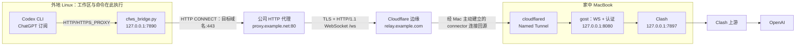

> 历史设计材料（已脱敏）。后续已新增独立参考桥；新部署以[完整手册](完整配置与使用手册.md)为准，本文的“当前”和“尚未”描述历史时点。

# TransCodex：沿用已验证链路，升级固定域名与自动恢复

根据 [历史实测摘要](历史实测摘要.md)，外地设备只能经公司 HTTP 代理访问获准目标，UDP 全禁，直接出网基本不可用。记录中的 Cloudflare Quick Tunnel + Python WebSocket 桥已于 **2026-10-27 完成订阅版 `codex exec`**。

因此主方案调整为：**保留已跑通的桥接路径，升级 Cloudflare Named Tunnel、固定域名与服务托管，并修正桥的长连接处理。当前无需购买 ECS 或 EIP。** 原双 SSH 方案依赖的直连条件不成立，已移出实施路径。项目背景与工作约定见 [AGENTS.md](../AGENTS.md)。

方案最初于 2026-11-02 修订。2026-11-03 完成 Mac 服务和 Cloudflare 固定域名部署；2026-11-04 用户从外地 Linux 使用 ChatGPT 订阅完成 `codex exec`，返回 `CONNECTION_OK`（2,390 tokens）。基础端到端使用已验收，模型目录刷新超时与长期稳定性仍待处理。当前操作见 [NEXT_LINUX.md](../NEXT_LINUX.md)，历史记录保持不变。

用户关闭 Mac 侧配置后的实际检查与逐步恢复操作见 [RECONNECT.md](../RECONNECT.md)，其中包含无凭据的 gost 模板；以下方案中的历史版本/部署状态不代表服务当前仍在运行。

用户已确认：**当前会话所在设备就是调试记录中的家中 MacBook**。Mac 侧组件可在本机直接核查；外地 Linux 是另一台设备，其结果由用户远端实测提供，不与 Mac 的测试混用。

## 1. 当前环境与证据

| 项目 | 外部记录中的状态 | 方案含义 |
| --- | --- | --- |
| Linux | RHEL 8 兼容 Linux，RHEL8/el8 兼容，systemd | 沿用现有 Python 桥和 systemd |
| 出口 | `proxy.example.net:80`，域名过滤，禁 UDP | Linux 桥必须显式使用公司代理 |
| Codex | CLI 0.151.0，`/usr/local/node24131/bin/codex` | 保持 ChatGPT 订阅认证作为验收方式 |
| 外地 Linux 桥 | `~/.local/bin/cfws_bridge.py`，`127.0.0.1:7890` | 运行于外地 Linux，保持现有端口 |
| Mac gost | 3.3.1，`127.0.0.1:8080`，WebSocket `/ws`，带认证 | 入口保持回环，出口显式经过 Clash |
| Mac Clash | `127.0.0.1:7897` | 最终 OpenAI 网络出口 |
| Mac cloudflared | 2026.10.3，Quick Tunnel、前台窗口 | 升级 Named Tunnel 和托管 |
| 域名 | 已购买 `example.com` | 拟使用 `relay.example.com`，尚未验收 |
| 端到端 | `codex exec` 正常回复，报告 13,634 tokens | 可运行基线已经存在，无需重新从组网试起 |

上述表格保留外部记录的历史版本。最新实际状态为：Named Tunnel 和固定域名已部署，Mac 服务已托管，外地 CLI 已为 0.164.0，并完成真实订阅调用；模型目录刷新和长期无人值守仍待验收。

## 2. 目标链路



Linux → Cloudflare 是公司代理上的 CONNECT + WSS/443；Mac cloudflared → Cloudflare 是独立的出站连接，使用 7844：QUIC 走 UDP，HTTP/2 走 TCP。公司的禁 UDP 约束不直接决定 Mac connector 的协议。可按 Mac 实测选择传输，不能把 Linux 桥的 HTTP/1.1 要求套到 connector 上。[Cloudflare 网络要求](https://developers.cloudflare.com/tunnel/configuration/)

不要求家庭公网 IP、入站端口映射或公网服务器。域名注册商可以留在阿里云，DNS 按标准 Cloudflare 接入方式委派。外地客户端以固定主机名访问边缘，Mac IP 变化后由 connector 重连。

工作区和命令执行留在 Linux，云端模型所需代码上下文仍发送至 OpenAI。外层 WSS 在 Cloudflare 终止，所以隧道认证和目标 CONNECT 元数据并非对 Cloudflare 不可见；内层 Codex → OpenAI HTTPS 保持证书校验，不在转发节点做内容解密。

## 3. 从调试记录保留什么、纠正什么

| 记录中的结论或做法 | 修订后的处理 |
| --- | --- |
| Quick Tunnel 已完成真实 Codex 请求 | 保留为迁移前基线 |
| gost 原生客户端在该路径发生 ALPN/Upgrade 握手失败 | 保留 Python 桥的 HTTP/1.1 路径；这是该版本与该路径的结果，不是所有 HTTP/2 WebSocket 的通则 |
| gost 必须 `-F http://127.0.0.1:7897` | 保留，避免回到家庭网络直连 |
| Tailscale 控制面能登录，但 UDP/DERP 路线受阻 | 记录具体障碍，当前不重新默认部署 |
| Quick Tunnel 隔夜失败，推断闲置回收 | 保留故障现象，回收根因待日志证明；进程重启、代理 DNS 缓存和 connector 失联需区分 |
| Named Tunnel 能固定入口 | 保留；它不保证已有连接永不中断 |
| 其他网站可访问，因此自有域名默认放行 | 移除推断，必须从公司代理测试新域名 |
| 403/405 即代表全链路正常 | 改为分层证据，真实订阅请求才验证完整路径 |
| 每个 CONNECT 一条 WS，因此不存在长连接问题 | 修正：一个 CONNECT 也可持续很久，仍需心跳、超时与资源管理 |

Cloudflare 将 Quick Tunnels 定位为测试/开发用临时 URL，长期入口应使用正式 Tunnel。边缘服务更新和空闲策略仍可能关闭 WebSocket，因此固定域名与连接恢复要分别设计。[Quick Tunnels](https://developers.cloudflare.com/tunnel/get-started/quick-tunnels/)、[WebSocket 连接行为](https://developers.cloudflare.com/network/websockets/)

## 4. Named Tunnel 迁移步骤

### 4.1 DNS 与公司代理可达性

1. 在 Cloudflare 添加 `example.com`，核对现有 DNS 记录；在阿里云注册商处将 NS 改为 Cloudflare 分配的值，确认站点 Active。
2. 拟定公共主机名 `relay.example.com`。按当前远程管理路线创建 Named Tunnel，在控制台把该 hostname 映射到 Mac 的 `http://127.0.0.1:8080`。使用 HTTP 回环回源以承载现有 WebSocket Upgrade。
3. connector 和路由就绪后，从外地经公司代理依次验证：CONNECT 返回 200、TLS 主机名与证书校验成功、`GET /ws` Upgrade 返回 101。
4. 验证失败时保留已知可用路径作为临时回退，先定位公司域名策略、DNS、TLS 或边缘配置；新域名若被阻止，需要确认获准的访问入口。不要通过更换 Host/SNI 或关闭证书校验伪装目标。

采用控制台远程管理配置，避免同时维护另一套本地 `tunnel create/config.yml` 作为同一隧道的配置来源。标准域名接入需要完成 NS 委派；不是将域名 A 记录指向 ECS。参考 [控制台创建 Tunnel](https://developers.cloudflare.com/cloudflare-one/networks/connectors/cloudflare-tunnel/get-started/create-remote-tunnel/)、[标准 DNS 前提](https://developers.cloudflare.com/tunnel/features/locally-managed-tunnels/create-local-tunnel/)。

### 4.2 Mac connector、gost 与 Clash

- 按控制台生成的 macOS 命令注册 connector，token 不写入本项目；选定一种服务管理方式，避免与原 Quick Tunnel 窗口或另一套相同标签的服务重复运行。
- 将 gost 独立托管到 launchd，继续监听 `127.0.0.1:8080`，使用带认证的 `/ws`，出站指向 `http://127.0.0.1:7897`。正式凭据从受限配置读取，不将密码放在共享启动命令或文档中。
- 先保留已验证版本，迁移固定域名后再逐一评估升级。二进制与配置均使用绝对路径，核对服务身份、配置读取权限、重试间隔和日志轮换。
- 明确启动目标：登录后使用 LaunchAgent；需要系统启动阶段运行时评估 LaunchDaemon。`cloudflared service install` 与 `sudo cloudflared service install` 的运行上下文不同，安装后检查实际 plist。即使 connector 开机启动，Clash GUI 仍可能等待用户登录。
- 不以服务启动顺序假定依赖已就绪；gost/connector 应容忍 Clash 或回环服务稍后恢复。

Cloudflare 的 macOS 服务文档区分登录启动和开机启动；不能将无 sudo 的安装统一描述为开机即全链路可用。[macOS 服务说明](https://developers.cloudflare.com/tunnel/features/locally-managed-tunnels/as-a-service/macos/)

### 4.3 Linux 桥切换

- 保持 `CORP_PROXY=proxy.example.net:80`、`WS_PORT=443`、`WS_PATH=/ws` 和监听 `127.0.0.1:7890`，将 `WS_HOST` 切为固定域名；SNI、HTTP Host 和证书校验目标一致。
- 在代码加固时将端点、用户名与密码从源码常量迁移至独立配置。旧密码曾明文出现在记录中，正式迁移时生成新凭据并同步两端，新文档不复用原值。
- 沿用 `cfws-bridge.service`，完善 `User`、明确的配置路径、`Restart=always`、`RestartSec=5s`、启动限流策略和日志。现有 unit 未指定用户，按 systemd 系统服务通常会以 root 运行，后续应改为合适的普通用户。
- systemd 不继承 `.bashrc`；桥自身显式连接公司代理。非交互调用 Codex 时通过包装脚本或进程环境传入本地代理，不能只依赖 shell 函数。
- 固定域名下完成全链路与恢复验收后，才退役 `switch-tunnel` 和旧 Quick Tunnel。回退依赖旧入口仍有效；随机域名不能视作永久备用。

Codex 启动时沿用已验证的入口，必要时统一大小写并清理冲突的代理变量。可在外地项目目录显式启动：

```sh
env -u ALL_PROXY -u all_proxy \
  HTTP_PROXY=http://127.0.0.1:7890 \
  HTTPS_PROXY=http://127.0.0.1:7890 \
  http_proxy=http://127.0.0.1:7890 \
  https_proxy=http://127.0.0.1:7890 \
  NO_PROXY=localhost,127.0.0.1,::1 \
  no_proxy=localhost,127.0.0.1,::1 \
  /usr/local/node24131/bin/codex
```

内网工具需要直连的域名应合并进实际 NO_PROXY。桥只支持 CONNECT，普通明文 HTTP 转发尚未实现；不能据此承诺所有子命令或包管理器都能联网。

ChatGPT 订阅登录继续保留。外部记录中的登录缓存已经跑通过，但本次未读取缓存；后续让外地 CLI 管理自身登录刷新，不持续从 Mac 覆盖 token，也不把 `auth.json` 粘贴进聊天或日志。API Key 测试不是订阅认证迁移步骤。

## 5. 桥代码必须处理的稳定性问题

以下来自对外部记录附录 A 的静态审阅，**尚未修改远端实现，也未在本仓库生成桥的替代程序**。

| 优先级 | 附录中的具体问题 | 修正要求与验证 |
| --- | --- | --- |
| P1 | `ws_recv()` 收到 Ping 直接忽略 | 回复相同载荷的 masked Pong；主动心跳记录 Pong 与失联；所有帧发送共用锁，防止心跳和业务写入交错 |
| P1 | `create_connection(..., timeout=30)` 后没有设置独立的数据期策略 | 核对 TLS socket 继承的超时，区分连接/握手超时与数据空闲；不要让短暂无业务数据被 30 秒读超时切断 |
| P1 | `read_until()` 一次读取可能同时获得头和后续字节，调用者没有保留尾部 | 返回头与剩余缓冲，交给后续协议层；限制头长度，正确处理 EOF 与超限，不能静默丢字节 |
| P1 | 上游 CONNECT 仅调用一次 `ws_recv()` 判断 200 | 累积字节直到完整 HTTP 头；响应可能跨 WS 帧；保留同帧业务尾部，不把帧边界当成 HTTP 边界 |
| P1 | 只检验包含 `101` 的状态行 | 精确校验状态、Upgrade/Connection 和 `Sec-WebSocket-Accept`，保持证书与主机名校验 |
| P1 | `finally` 仅关闭 client，上游 socket 生命周期不完整 | 出错、EOF、close、超时都关闭两端并协调线程退出，验证 FD/线程数量不会持续上涨 |
| P2 | 帧解析没有完整的长度、opcode/RSV、分片和控制帧校验 | 按 RFC6455 处理分片及控制帧；超限拒绝并关闭，不能截断长度后继续错位解析；零长度数据帧不等于 EOF |
| P2 | 接受连接后没有完整的本地头超时与并发上限 | 限制握手时间、目标端口和并发；按实际 Codex 域名需求配置认证与目的地限制 |
| P2 | 异常被笼统吞掉或日志不足 | 记录故障阶段、错误类别、耗时与连接计数，禁止记录认证值和请求正文 |

收到 Ping 应返回相同载荷的 Pong、校验握手及控制帧行为属于协议要求；连接期与数据期超时也应独立设计。可以采用与公司代理、HTTP/1.1 路径兼容的成熟 WebSocket 实现，或保留标准库方案并补齐测试。[RFC6455](https://www.rfc-editor.org/rfc/rfc6455)、[Python SSL](https://docs.python.org/3/library/ssl.html)

主动心跳可从 20–30 秒、连续 3 次无回应作为测试起点；最终值依据公司代理和边缘实测确定。数据 socket 不简单改为无限阻塞而不配套失联检测。每个 CONNECT 独立建立 WS 的设计可以保留，但业务流已经开始后不能由桥透明重放模型请求。

## 6. 身份与暴露边界

- Named Tunnel 提供可公开访问的 hostname；Mac 无公网入站端口不等于没有公开代理入口。gost 认证必须保留并使用新秘密，限制目的地与端口，监听继续保持回环。
- 若启用 Cloudflare Access，需要在桥的 Upgrade 请求中接入相应机器身份认证；直接启用浏览器交互登录可能返回重定向/拒绝，现有桥不能自动完成。
- Cloudflare connector token、gost 密码、Codex token 与备份分别保管在权限受限文件中，不进入仓库、命令输出或普通日志。本次没有读取、复制或轮换真实认证缓存。
- 外层 WSS 的证书与 SNI、内层 OpenAI 的 TLS 校验都保留；企业 CA 的信任通过正规配置处理。

## 7. 分层排障与恢复

| 阶段 | 检查内容 | 失败时优先检查 |
| --- | --- | --- |
| 本地监听 | `cfws-bridge` 活跃且 `127.0.0.1:7890` 可接受 CONNECT | 服务身份、配置、端口占用、桥日志 |
| 公司 CONNECT | 代理对固定域名 443 返回 200 | 域名策略、代理 DNS/缓存、认证、网络；302 不能唯一证明域名回收 |
| TLS | 固定域名证书和 SNI 正常，采用已验证的 HTTP/1.1 路径 | 信任链、主机名、代理 TLS 检查、协议协商 |
| WebSocket | `/ws` 精确返回 101 且握手校验通过 | Named Tunnel 路由、connector、gost、Access/WAF/挑战策略及请求头 |
| 内层 CONNECT | gost 认证通过并返回完整 200 | 密码、目的地限制、Clash 的 7897 监听和上游 |
| OpenAI/Codex | 订阅登录状态与真实简单任务完整响应 | token/刷新、端点、上游策略、限流、服务端错误 |

未带 API 凭据的 `/v1/models` 返回 401 可作该端点的可达性证据；405 只说明请求方法不被接受；403 可能来自公司代理、Cloudflare 或目标服务。响应状态要结合阶段与来源，不能统一判为“链路正常”。记录中的模型列表子进程超时当时未阻止任务，但持续出现时仍需单独诊断。

服务托管仅能在进程退出时拉起；桥线程卡住、gost 存活但出口失效时，进程状态可能一直正常。低频健康检查记录阶段和耗时，连续失败后只恢复相应组件并退避；不把 HTTP 401/403/429 都当作重启理由。正常健康检查不应反复运行消耗订阅额度的模型任务。

## 8. 验收顺序与回退

1. **保存基线**：记录两端版本、当前服务配置、现有端点和可用回退方式；秘密另行受限备份。
2. **固定入口**：站点 Active、Named Tunnel 路由正确，公司 CONNECT/TLS/WS/内层 CONNECT 逐层成功。
3. **真实使用**：外地 CLI 使用 ChatGPT 订阅完成简单任务与流式响应，检查登录刷新和非交互启动。
4. **空闲与并发**：超过旧 30 秒超时窗口的无业务数据场景、长时间流式连接、过夜后新请求、多 CONNECT、Ping/close/分段头等均通过；观察 FD/线程是否回落。
5. **恢复演练**：公司代理短暂失联、Mac 切换 Wi-Fi、Clash/gost/cloudflared 退出或重启、两端重启后，验证新请求恢复；不要只验证杀进程后服务重新启动。
6. **无人值守边界**：分别验收关闭终端、退出登录、系统睡眠/合盖和冷启动。Mac 保持接电与唤醒，FileVault/Clash 登录依赖明确记录。
7. **切换完成**：基础网络、connector 与 Clash 恢复后争取 1–2 分钟内可完成新请求；该目标待实测。稳定运行后退役临时域名切换工具。

Named Tunnel 不保证中断中的 TCP、WebSocket 或模型响应无损续传。旧 Quick Tunnel 尚有效时可将端点和配置恢复到基线；若旧 URL 已失效，回退需要重新获取临时 URL，并不承诺它长期可用。

## 9. 当前部署状态与待完成事项

- Mac 和 Cloudflare 已部署，外地 Linux 已通过 API 网络和真实 ChatGPT 订阅调用（CLI 0.164.0、gpt-6-sol、CONNECTION_OK）。模型目录刷新仍超时，长时间稳定性尚未验收，下一步见 `NEXT_LINUX.md`。
- 本仓库只有方案与历史记录；附录提到的脚本、图和运维工具不因被文档引用而自动存在于本仓库。
- Mac gost 已安装和配置、生成了新代理密码，并由 LaunchAgent 托管，局部认证/TLS/进程恢复已验证；cloudflared 已由用户执行 connector 命令安装为系统服务，`transcodex-home` Healthy，固定域名指向本机 `8080`。
- 外地桥代码加固、Linux unit 修订、凭据同步及真正的两端全链路恢复演练尚未执行。
- 未购买或配置公网服务器，未读取或复制 Codex 登录缓存、Cloudflare token。
